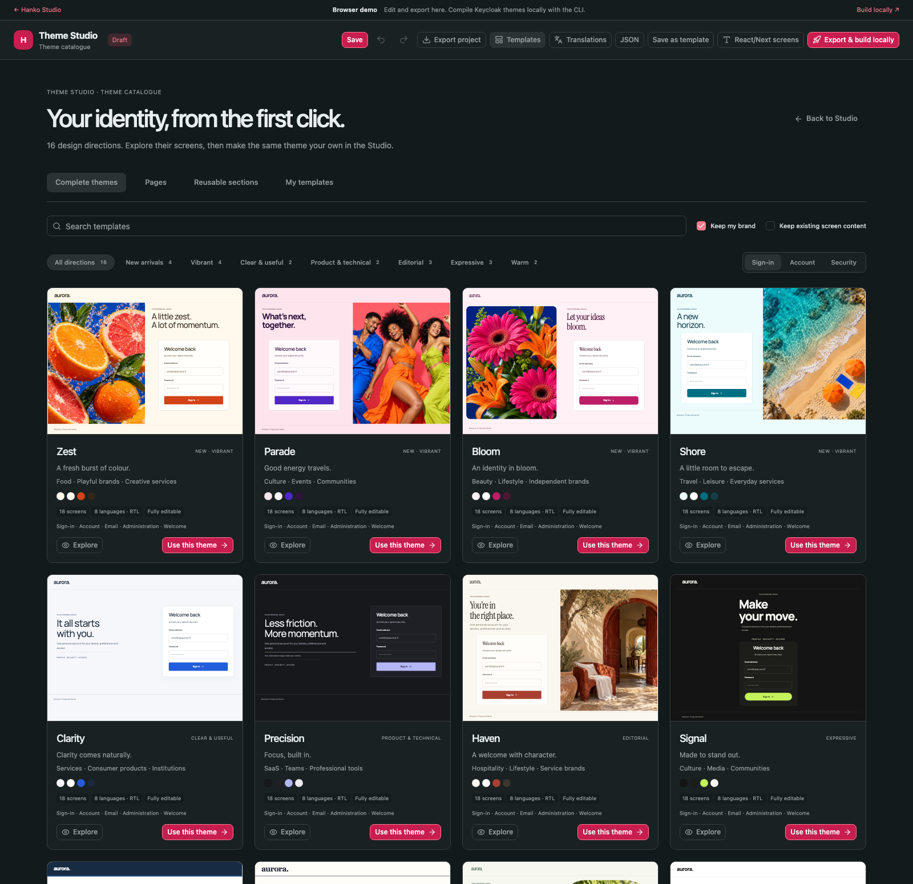
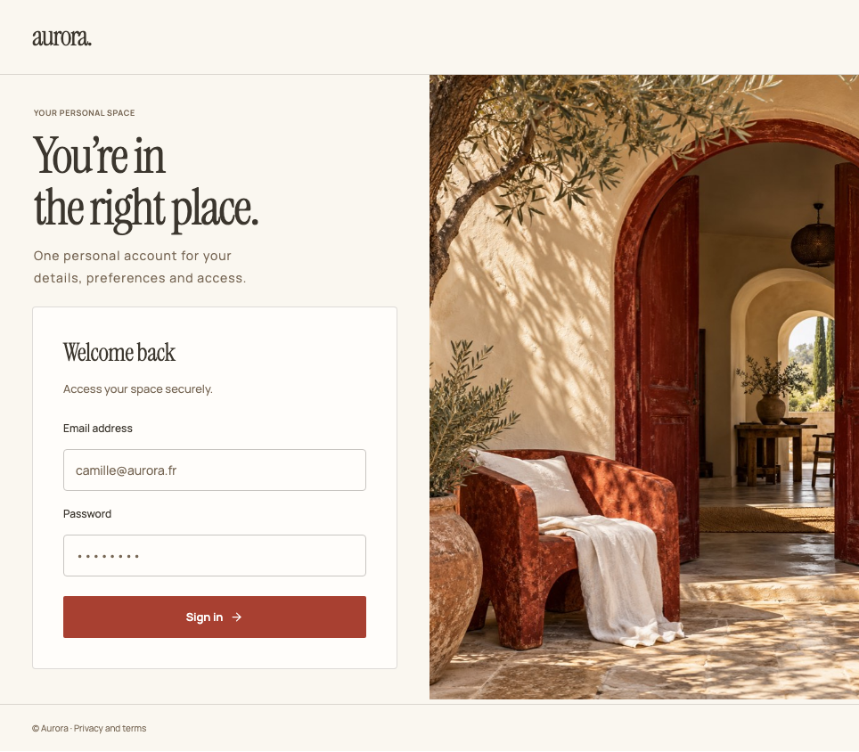

# Hanko Theme Studio

Visual editor shared by the standalone builder and the Hanko Dashboard. React module, shadcn/Radix controls, scoped styles, guided blocks, media uploads, editable translations and interactive account/administration previews.

The gallery includes **16 complete themes**: 18 screens each, eight content languages including Arabic and Hebrew RTL, eight photographic directions and four reusable sections. The gallery, exploration dialog and editor use the same catalogue documents and rendering frame. Previews start in English and preserve the selected language when opened in the editor. Apply a whole theme or one page while choosing whether to retain your brand and existing content. Save personal templates in the host library; standalone projects and templates use IndexedDB in the current browser. Export JSON for backup and sharing. The gallery and its theme descriptions use English. Editing controls are currently French; theme content supports all eight languages. Projects show their unsaved state, and a document close/reload prompts when changes remain. Browser history and deep links for editor states are not connected yet.

Try the [public Studio](https://studio.hanko.sh/app/?locale=en). It opens in the HankoShell dark palette with red accents. The browser demo supports editing and exports; native compilation requires the local CLI. It has no build service or connection to your Keycloak server. Embedded hosts can choose light, dark or system colours with `colorScheme`.

## Gallery and live editor





The screenshots come from the standalone build and contain demo data. Regenerate them with `npm run build:site && npm run screenshots:readme` after installing the parent builder's Playwright development dependency.

## Run and verify

Requires Node 22. From this directory:

```sh
npm ci
npm run build
npm test
npx tsc --noEmit
npm run dev
```

Open <http://127.0.0.1:7425/>. Use `?locale=fr` for French content previews, or set `initialLocale` when embedding. Browser qualification uses `node test/browser.mjs` while the dev server is running; Playwright is provided by the parent builder development installation.

## Publishable standalone build

```sh
npm run build:site
python3 -m http.server 7426 --bind 127.0.0.1 --directory site
```

Open <http://127.0.0.1:7426/>. The `site/` directory is static and supports subdirectory hosting. Schema validators are generated at build time and loaded on demand; no development API or runtime JavaScript compilation is needed. Embedding hosts may still provide `contractsBase` for their own authenticated validation endpoint. Server-side validation and authorization remain mandatory for host persistence.

`npm run package:release` prepares a website ZIP, npm archive, manifest and SHA-256 sums in `artifacts/release/`. Stable releases use the npm `latest` channel; prereleases use `preview`. Its manifest reports any uncommitted source changes; these files are not a published release.


## Navigation map

**Modèles** in the main toolbar opens the gallery of complete themes, pages, reusable sections and saved models. The editor sidebar contains **Blocs**, **Styles**, **Médias** and **Calques**. **Styles** adjusts the current screen's colors, font, layout, spacing and corners; color palettes preserve its content, translations and media. The inspector's **Style** tab adjusts the selected element. Applying a model belongs exclusively to the gallery.

Choose a theme type, then navigate using its section tabs and child pages. The editor has no parallel screen dropdown or repeated breadcrumb above the canvas. The **Plan** button exposes the Studio workspaces and the theme screen hierarchy. `sitemap.xml` is an application navigation map with parent/child states and demo transitions, not a search-engine indexing file. `npm run sitemap` generates both the XML and `public/sitemap.html` from `src/navigation.ts`; the same definitions drive the menus. Security contains password, authenticator and sessions; administration contains users/user detail, clients/client configuration and permissions. Navigation preserves the project destination and undo history.

## Embed

Install `@alien6-studio/hankoshell-theme-studio` with npm.

```tsx
'use client';
import {ThemeStudio} from '@alien6-studio/hankoshell-theme-studio';
import '@alien6-studio/hankoshell-theme-studio/styles.css';

<ThemeStudio
  embedded
  initialView="gallery"
  context={{kind:'organization', id:organization.id, label:organization.name, realm:organization.realm}}
  initialProject={loadedProject}
  contractsBase="/api/theme-studio/contracts"
  onSave={saveProject}
  templates={templateMetadata}
  onLoadTemplate={loadTemplate}
  onSaveTemplate={saveTemplate}
  publication={{builds, build: buildSavedProject, status: observeBuild,
    attach: assignInstalledTheme, rollback: restorePreviousAssignment}}
/>
```

Load this browser component without SSR in Next.js. The host owns authentication, scope enforcement and persistence; no credentials belong in project JSON. Contract endpoints expose GET `/{kind}` and POST `/validate` with `{kind,document}`. The `./contracts` export is server-only and validates the bundled schemas with Ajv. Plugin declarations do not install executable renderers. Unknown renderer types must be rejected by the host.

## Catalogue source

`@alien6/hankoshell-theme-catalog` provides the canonical theme manifest, 288 authored page documents, shared translations and authored layout recipes. Theme content, photographs, font sources, generation prompts and design documentation live in the [hankoshell-theme-catalog](https://github.com/Alien6-Studio/hankoshell-theme-catalog) repository. Studio owns the editing controls and generic renderer. There is no editable catalogue copy here.

The builder pins a reviewed archive and its provenance under `vendor/`. From the builder root, run `npm run catalog:update -- /path/to/theme-catalog.tgz`, then rebuild Studio. This updates both lockfiles without requiring a sibling checkout. Built package archives include the catalogue content and remain independently installable. The release manifest records the catalogue revision and archive SHA-256.

The **Vibrant** filter selects Zest, Parade, Bloom and Shore. The old `design-proposals.html` URL opens this same Studio gallery. Gallery cards use four columns on large screens, three on standard desktop screens, two on tablets and one on mobile. Light/dark Studio colors are scoped to the Studio shell; each theme owns its preview colors, input placeholders and typography. Self-contained font faces require `font-src 'self' data:` in a hosting CSP; script execution remains restricted to local scripts.

`npm run test:coherence` compares the actual gallery and editor text, colors, fonts, layout and image framing for every theme, then verifies all 288 page documents after JSON export. It also checks light/dark color isolation and responsive gallery density. `npm run test:continuity` checks every desktop screen, representative mobile screens and the contrast of photographic account, admin, email and welcome pages. Repeated photographs are shared in JavaScript bundles while exported JSON stays self-contained.

## Export boundaries

Project JSON contains the full composition. React/Next exports reproduce the authored account, administration and welcome pages: blocks, images, styles, native labels, translations and navigation. React is the only required runtime package; the host connects its authenticated forms and operations. Administration interactions inside the Studio use demo data. The native compiler consumes guided login, registration, OTP and email compositions, including blocks, images, styles and translations. Other login flows retain native Keycloak forms inside the shared layout. In a compatible Hanko host, the publication screen saves and freezes a revision, observes operator build/installation, then requests realm or client assignment and guarded rollback. The standalone editor displays the export and CLI installation path. Its browser does not hold Keycloak administrator credentials.

The host implements `StudioPublicationHost`: `build(project)` must persist and freeze the source; `status(id)` returns observed build state; `attach(id,destination)` and `rollback(id)` return pending receipts until Keycloak confirms the settings. Pass historical receipts as `builds`. A realm supports login and email; a client supports login only. Native email subjects accept literal translations, with supported user variables in the body. Cluster builds require the compatible operator CRDs, API migration 036 and a reviewed compiler image. Saving a project records a draft and never implies deployment. Angular remains a future adapter. Authenticator previews use transient demo secrets that are excluded from project and template exports.

## Application screen export

Use **Écrans React/Next** to download a TSX module containing the project's application pages. Import it into a React application or a Next.js client component:

```tsx
'use client';
import type {ReactNode} from 'react';
import {ProfileScreen, type IdentityScreenContext} from './identity';

export function AccountPage({renderAuthenticatedScreen}: {
  renderAuthenticatedScreen: (context: IdentityScreenContext) => ReactNode;
}) {
  return <ProfileScreen locale="fr" renderNative={renderAuthenticatedScreen}/>;
}
```

The callback receives the current screen ID, localized page, locale and `onNavigate`. It renders the application's real fields, data and actions. `IdentityInput` and `IdentityButton` are optional helpers that apply edited field labels and styles; field values and change/submit handlers belong to the host. A Hanko application can connect its ADK through this callback. Organization, resource and permission operations require the corresponding authenticated host implementation.

Use `IdentityScreen` for the first exported screen, or a named component such as `ProfileScreen` for a page present in the project. `applicationScreenIds` lists the included pages. Navigation is local by default; a host router can control it with `screen` and `onNavigate`. A button targeting `#account-1` opens the exported security page. Locale falls back to the page's configured default; Arabic and Hebrew use RTL layout. The exported source contains no demo authenticator secrets or authenticated session.

`npm run test:application` exercises a real Studio download in a separate React application, including authored content, host-controlled fields, navigation, Hebrew RTL and mobile layout.
